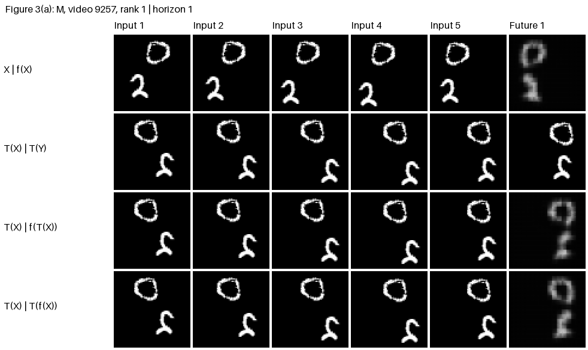
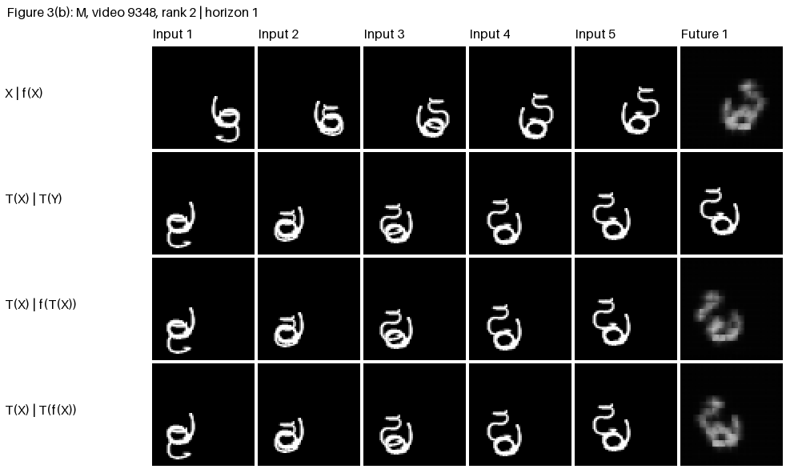
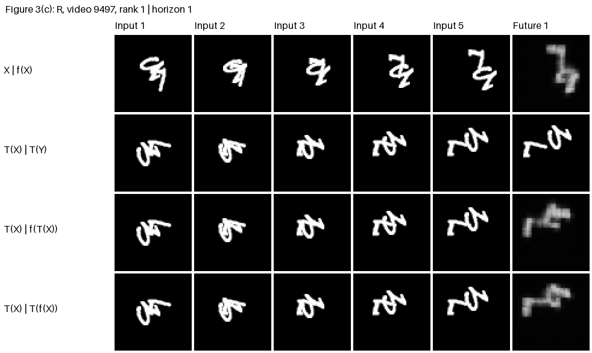
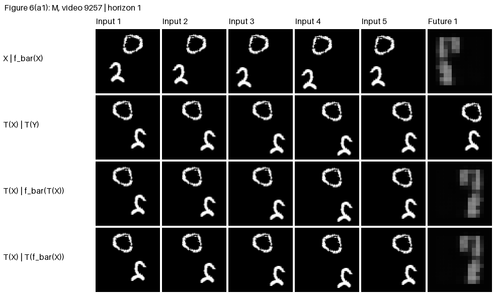
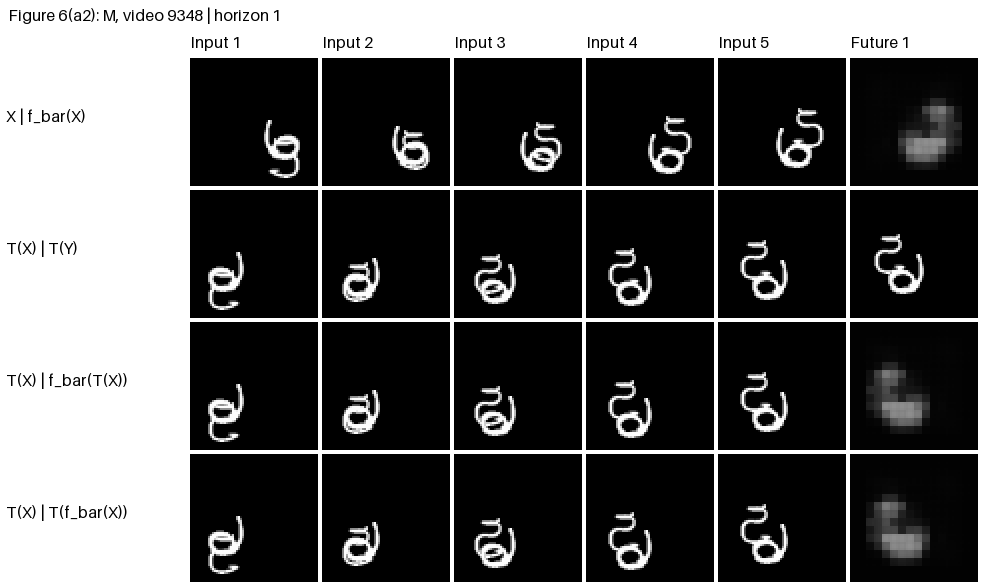

# AI651 Assignment 2 (Fall 2026)

Muhammad Bin Tariq (27100017)

Deep Learning for Space, Time and Graphs. Question 1 proposes a river forecasting system. Question 2 studies motion, symmetry and spatial reach using Moving MNIST and ConvLSTM models.

| Path | Contents |
|---|---|
| [Combined report](output/pdf/DL4STG_PA2_Report.pdf) | Start here: the Q1 proposal and completed Q2 study |
| [report/main.tex](report/main.tex) | Main LaTeX document and cover |
| [report/question1.tex](report/question1.tex) | Q1 proposal under the six required headings |
| [report/answers/](report/answers/) | Written answers to Q2.1–Q2.17 |
| [report/figures/](report/figures/) and [report/tables/](report/tables/) | Figure assets and tables included in the report |
| [LaTeX source bundle](output/pdf/DL4STG_PA2_Report_Source.zip) | Complete editable report project |
| [DL4STG_PA2_Q2.ipynb](DL4STG_PA2_Q2.ipynb) | Final executed Colab notebook, including code, outputs and answers |
| [outputs/](outputs/) | Exported figures, tables, full-precision metrics and example selections |
| [outputs/gifs/](outputs/gifs/) | Animated baseline and final-model forecasts |
| [predictions/](predictions/) | Predictions recorded before the relevant experiments |

## Question 1

The proposal predicts water levels one hour ahead at S1–S4, with forecasts issued every ten minutes. It combines historical water levels, rainfall and reservoir releases with future release schedules announced before issuance.

The architecture alternates spatial attention across eight locations with temporal convolution over the observed history. It follows Chapter 6 and uses no GNNs. The report specifies input dimensions, assumptions, model computations, missing and delayed observations, and remaining uncertainty. Q1 is a design proposal; no training run or implementation is claimed.

## Question 2

Model A uses `pixel_unshuffle(4)`, two 64-channel ConvLSTM layers with 3×3 kernels, and a 1×1 readout followed by `pixel_shuffle(4)` and sigmoid. The split is videos 0–7,999 for training, 8,000–8,999 for validation, and 9,000–9,999 for testing.

All learned models use 30 epochs, Adam at 1e-3, batch size 32, seeds 0 and 1, and final-epoch weights. Runs used an NVIDIA A100-SXM4-40GB.

| Model | Change |
|---|---|
| A | Baseline trained on 1× motion |
| B | A with uniform square-symmetry augmentation |
| C | A with uniformly sampled 1×, 2× and 3× motion |
| D | C with dilation 2 and padding 2 in the second ConvLSTM layer |
| Final | Symmetrised D: average eight complete inverse-transformed forecasts |

A–D each have 480,784 parameters. D increases reach from 8 to 12 original pixels per axis. Symmetrisation shares the same weights and requires no additional training. Tables 1–6 and Figures 1–6 are included in the report, with both symmetrised B and D evaluated in Table 6.

### Running the notebook

For a full reproduction, run the notebook stages in order in Colab. Runtime files live under `MyDrive/DL4STG_PA2`: data in `data/`, exports in `outputs/`, and checkpoints in `training_runs/{model}_seed{seed}/`. Datasets, checkpoints and large prediction tensors are excluded from Git.

With completed Drive checkpoints, the fresh-runtime restore orders are:

- **Baseline stress tests:** sections 1–4, 6–7, 14–15, 24, then 28–36.
- **B–D training/evaluation:** sections 1–4, 6–7, 14–16, 20, 24, 28–29, then 37–46. Sections 16 and 20 supply the loss and checkpoint helpers.
- **Final evaluation:** sections 1–4, 6–7, 14–15, 38, then 47–53. Stage 9 includes its own evaluation helpers and requires no training.

Completed training calls resume without adding epochs. Section 53 creates `q2_final_results.zip` in Drive; its report-sized exports are tracked in `outputs/`.

### Predictions recorded before testing

- [Q2.5](predictions/Q2.5.md) was committed before baseline stress tests in `31adeaa`. The earlier [answered notebook](DL4STG_PA2_Q2_2-5.ipynb) is retained.
- [Q2.11](predictions/Q2.11.md) was committed before B–D training in `2e5b8f5`.

Both predictions remain unchanged in the report.

### Figure 3 GIFs

Baseline model A, seed 0. Each animation steps through the five forecast horizons. Cases are the two largest per-video consistency gaps for each transformation.

**Mirror — video 9257**



**Mirror — video 9348**



**Rotation — video 9497**



**Rotation — video 9925**


### Figure 6 GIFs

Symmetrised D on the same four videos. The transformed-input and transformed-output forecasts agree up to floating-point rounding; agreement does not guarantee accurate forecasts.

**Mirror — video 9257**



**Mirror — video 9348**



**Rotation — video 9497**


**Rotation — video 9925**


## Compiling the report

With XeLaTeX available, run from the repository root:

```powershell
cd report
.\build.ps1
```

The script compiles twice and updates `output/pdf/DL4STG_PA2_Report.pdf`. On Overleaf, upload the source bundle, select `main.tex` as the main document and XeLaTeX as the compiler. The earlier Q2-only report is retained in `output/pdf/`.
